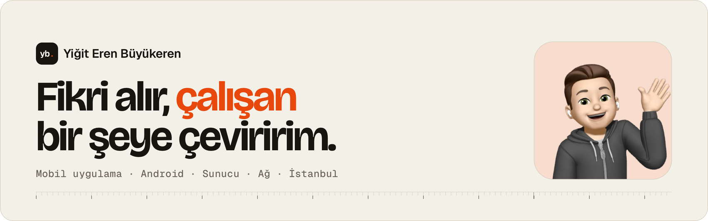
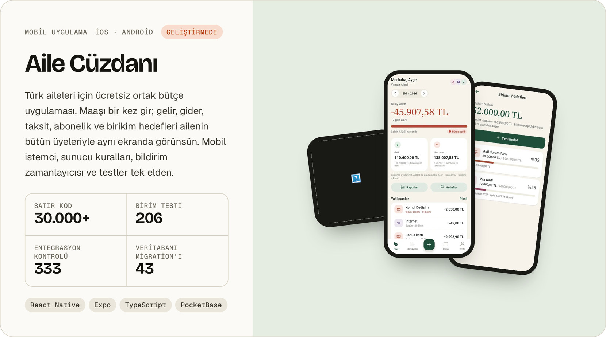
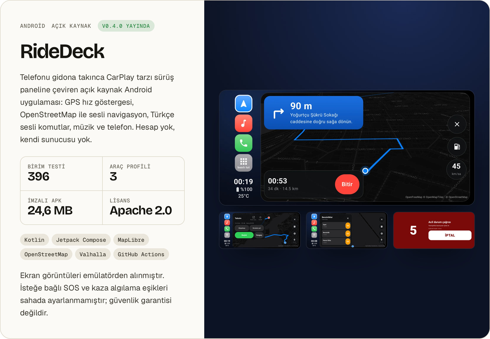
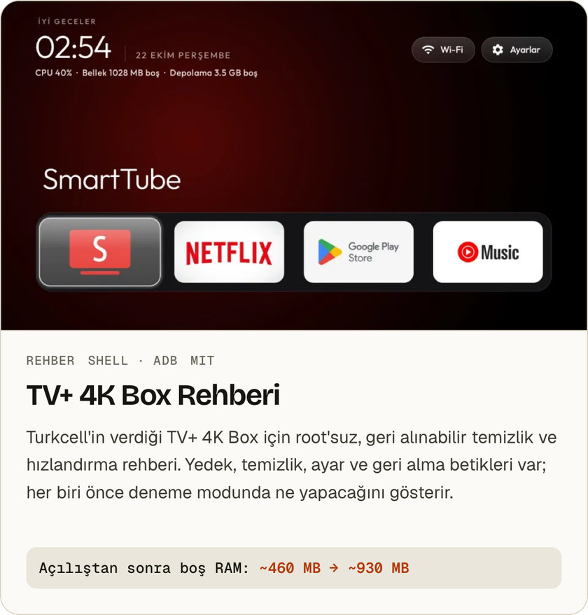
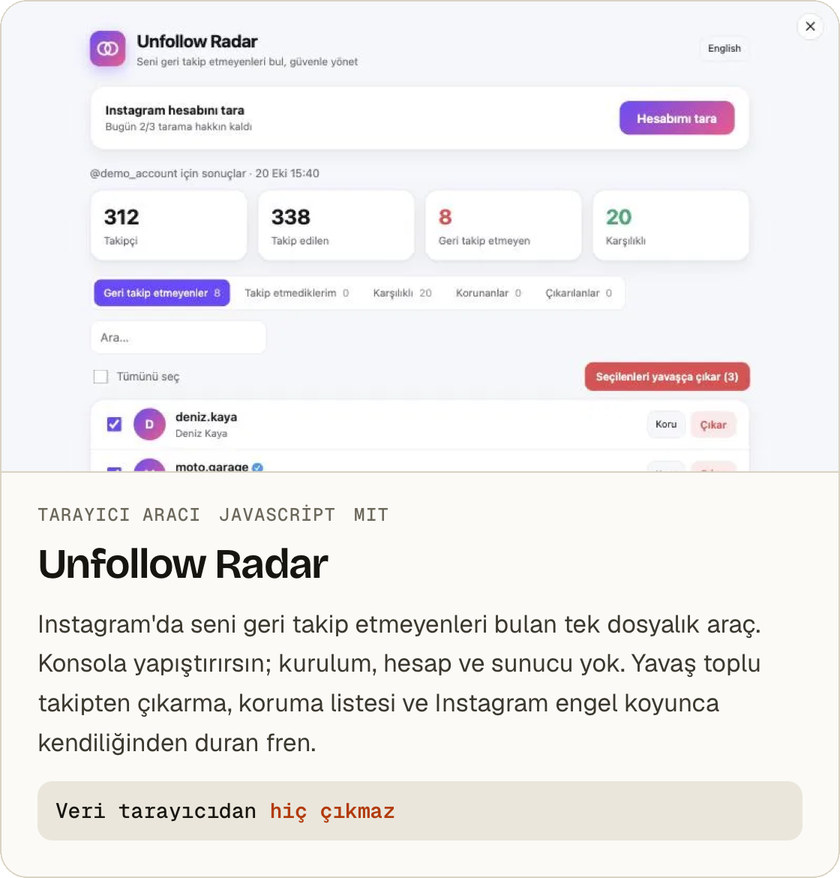
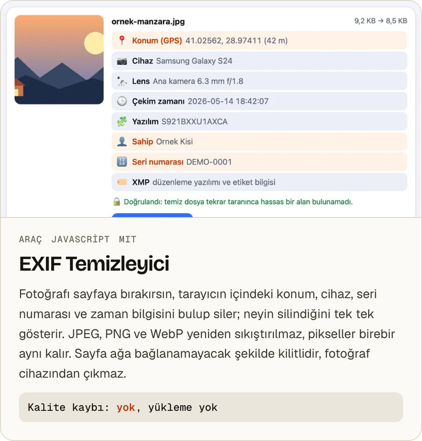
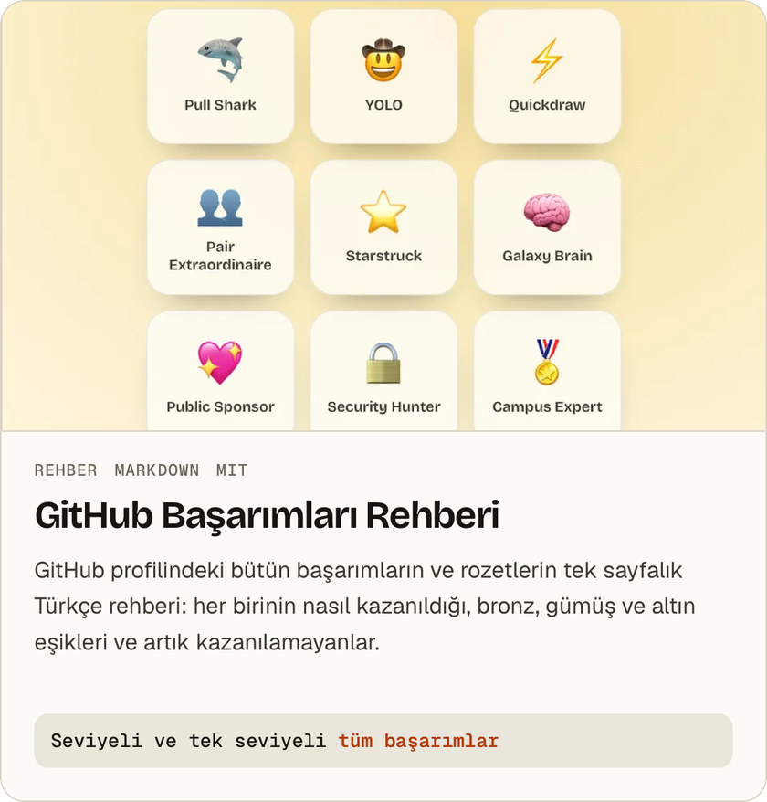

<a href="https://yigitbuyukeren.com">
  <picture>
    <source media="(prefers-color-scheme: dark)" srcset="assets/banner-dark.jpg">
    
  </picture>
</a>

**[🌐 yigitbuyukeren.com](https://yigitbuyukeren.com)** &nbsp;·&nbsp; **[✉️ mail@yigitbuyukeren.com](mailto:mail@yigitbuyukeren.com)** &nbsp;·&nbsp; **[🇬🇧 English](https://yigitbuyukeren.com/en/)**

👋 Merhaba, ben Yiğit. Mobil uygulama, Android, sunucu ve ağ üzerinde çalışıyorum. Ekrandaki arayüzü de, arkasındaki sunucuyu da, onu ayakta tutan altyapıyı da kendim kurarım ve çalıştığını testle gösteririm.

## 🧭 Seçili işler

<a href="https://yigitbuyukeren.com/aile-cuzdani/">
  <picture>
    <source media="(prefers-color-scheme: dark)" srcset="assets/aile-dark.jpg">
    
  </picture>
</a>

🌿 **Aile Cüzdanı** · [Proje sayfası](https://yigitbuyukeren.com/aile-cuzdani/) · [Tanıtım deposu](https://github.com/yigitbuyukeren/aile-cuzdani-showcase)

<a href="https://yigitbuyukeren.com/ridedeck/">
  <picture>
    <source media="(prefers-color-scheme: dark)" srcset="assets/ride-dark.jpg">
    
  </picture>
</a>

🏍️ **RideDeck** · [Proje sayfası](https://yigitbuyukeren.com/ridedeck/) · [Kaynak kodu](https://github.com/yigitbuyukeren/ridedeck) · [APK indir](https://github.com/yigitbuyukeren/ridedeck/releases/latest)

### 🧩 Diğer işler

  <a href="https://github.com/yigitbuyukeren/tvplus-4k-box-rehber"><picture><source media="(prefers-color-scheme: dark)" srcset="assets/tvplus-dark.jpg"></picture></a>
  <a href="https://github.com/yigitbuyukeren/unfollow-radar"><picture><source media="(prefers-color-scheme: dark)" srcset="assets/unfollow-radar-dark.jpg"></picture></a>

  <a href="https://yigitbuyukeren.github.io/exif-temizleyici/"><picture><source media="(prefers-color-scheme: dark)" srcset="assets/exif-temizleyici-dark.jpg"></picture></a>
  <a href="https://github.com/yigitbuyukeren/github-basarimlari-rehber"><picture><source media="(prefers-color-scheme: dark)" srcset="assets/github-basarimlari-dark.jpg"></picture></a>

🎂 [Doğum Günü Sürprizi](https://github.com/yigitbuyukeren/dogum-gunu-surprizi) ([canlı demo](https://yigitbuyukeren.com/dogum-gunu/), [kendi sürümünü oluştur](https://yigitbuyukeren.com/dogum-gunu/olustur/)) &nbsp;·&nbsp; 💗 [Kalp QR](https://github.com/yigitbuyukeren/kalp-qr) (kalp şeklinde QR kod) &nbsp;·&nbsp; 💬 [Sohbet Özeti](https://github.com/yigitbuyukeren/sohbet-ozeti) ([canlı demo](https://yigitbuyukeren.github.io/sohbet-ozeti/))

## 🔭 Şu an

- 🟢 **Durum:** Yeni projelere açığım.
- 🌿 **Odak:** Aile Cüzdanı'nı mağaza yayınına hazırlıyorum.
- 🧼 **Son iş:** EXIF Temizleyici. Ondan önce GitHub Başarımları Rehberi ve TV+ 4K Box Rehberi.
- 🌐 **Site:** [yigitbuyukeren.com](https://yigitbuyukeren.com) baştan tasarlandı. Framework yok, düz HTML ve CSS, kendi sunucumda Caddy ile yayında.

## 🛠️ Nasıl çalışıyorum

1. ✅ **Önce kanıt.** Tip kontrolü, lint, birim testleri ve gerçek bir sunucuya karşı entegrasyon testleri geçmeden iş bitmiş sayılmaz.
2. 📝 **Yazıya dökülmüş kararlar.** Proje durumu, kararlar ve çalıştırma kılavuzları repoda durur. Aylar sonra dönen biri, ben dahil, nereden devam edeceğini bilir.
3. 🔒 **Gerektiği kadar veri.** RideDeck'te hesap ve sunucu yok, Unfollow Radar veriyi tarayıcıdan çıkarmıyor. Toplanması gerekmeyen veri toplanmaz.
4. ↩️ **Geri dönüşü olan değişiklik.** Canlı bir sisteme dokunan her adımın geri alma yolu olur: önce yedek, sonra deneme modu, gerekirse tek komutla geri dönüş.

## 🧰 Kullandıklarım

| | |
|---|---|
| 📱 **Mobil** |    |
| 🤖 **Android** |     |
| 🗄️ **Sunucu** |    |
| 🏗️ **Altyapı** |      |
| 🌐 **Web** |    |
| 🌍 **Ağ** | `TCP/IP` `Alt ağlar` `Temel yönlendirme` |

<b>🎓 Sertifikalar</b>

| Sertifika | Veren | Tarih |
|---|---|---|
| CCNA: Introduction to Networks | Cisco | Mart 2026 |
| Linux Unhatched | Cisco Networking Academy | Şubat 2026 |
| Introduction to Cybersecurity | Cisco | Şubat 2026 |
| Network Fundamentals Training (CCNA ITN) | Bilişim Academy | Şubat 2026 |
| Ağ Temelleri | BTK Akademi | Aralık 2025 |
| Bilgisayar Ağları | BTK Akademi | Aralık 2025 |

## ✉️ İletişim

**Bir fikrin mi var? Birlikte kuralım.** Proje, iş birliği ya da teknik bir soru için [mail@yigitbuyukeren.com](mailto:mail@yigitbuyukeren.com) adresine yazabilirsin. Genellikle birkaç gün içinde dönerim.

<h2>🇬🇧 English</h2>

I'm Yiğit, a software developer in Istanbul. I take an idea and make it work: mobile apps, Android, servers and networks. I build the interface, the server behind it and the infrastructure that keeps it running, and I prove it works with tests.

- 🌿 **[Aile Cüzdanı](https://github.com/yigitbuyukeren/aile-cuzdani-showcase)**: a free, shared budgeting app for Turkish families (React Native, Expo, PocketBase), in development.
- 🏍️ **[RideDeck](https://yigitbuyukeren.com/en/ridedeck/)**: an open-source, CarPlay-style Android riding dashboard for motorcycles, cars and bikes (Kotlin, Jetpack Compose).
- 📺 **[TV+ 4K Box Guide](https://github.com/yigitbuyukeren/tvplus-4k-box-rehber)**: a root-free, reversible cleanup guide and scripts for Turkcell's set-top box.
- 📡 **[Unfollow Radar](https://github.com/yigitbuyukeren/unfollow-radar)**: find who doesn't follow you back on Instagram; paste into the console, data never leaves the browser.
- 🎂 **[Birthday Surprise](https://github.com/yigitbuyukeren/dogum-gunu-surprizi)**: an eight-scene interactive birthday page in a single HTML file ([live demo](https://yigitbuyukeren.com/dogum-gunu/), [make your own](https://yigitbuyukeren.com/dogum-gunu/olustur/): fill a form, download the page).
- 💗 **[Kalp QR](https://github.com/yigitbuyukeren/kalp-qr)**: a single-file Python tool that turns an address into a heart-shaped QR code that still scans.
- 🧼 **[EXIF Temizleyici](https://github.com/yigitbuyukeren/exif-temizleyici)** (EXIF Cleaner): run it on your own machine and it strips the GPS location, device, serial number and timestamps; JPEG, PNG and WebP are not re-encoded, so pixels stay identical, and nothing is uploaded; there is also a command-line mode for whole folders ([demo](https://yigitbuyukeren.github.io/exif-temizleyici/)).
- 🏆 **[GitHub Achievements Guide](https://github.com/yigitbuyukeren/github-basarimlari-rehber)**: every GitHub profile achievement and badge, how to earn each one, tier thresholds and the retired ones (in Turkish).
- 💬 **[Sohbet Özeti](https://github.com/yigitbuyukeren/sohbet-ozeti)**: drop a WhatsApp chat on the page and get stats, reply times and heatmaps; it runs in the browser and can't make network requests ([live demo](https://yigitbuyukeren.github.io/sohbet-ozeti/)).

More on [yigitbuyukeren.com/en](https://yigitbuyukeren.com/en/) · [mail@yigitbuyukeren.com](mailto:mail@yigitbuyukeren.com)

Görseller [yigitbuyukeren.com](https://yigitbuyukeren.com)'un kendi kartlarından üretilir: [`tools/render.sh`](tools/render.sh).
