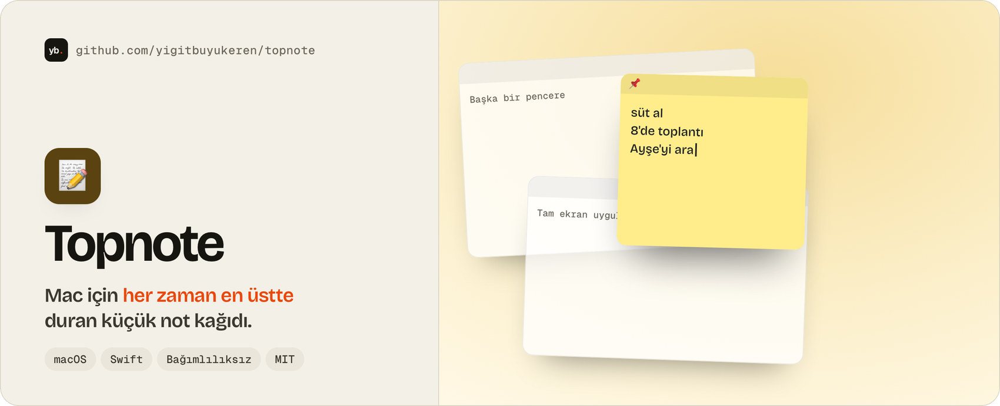

<a href="https://yigitbuyukeren.com">
  <picture>
    <source media="(prefers-color-scheme: dark)" srcset="assets/banner-dark.jpg">
    
  </picture>
</a>

# Yiğit Eren Büyükeren

**Software Developer: Android, Mobile & Backend Systems** · İstanbul

**[🌐 yigitbuyukeren.com](https://yigitbuyukeren.com)** &nbsp;·&nbsp; **[📄 CV (PDF)](https://yigitbuyukeren.com/cv/Yigit-Eren-Buyukeren-CV-TR.pdf)** &nbsp;·&nbsp; **[✉️ mail@yigitbuyukeren.com](mailto:mail@yigitbuyukeren.com)** &nbsp;·&nbsp; **[🇬🇧 English](#-english)**

Android, mobil ve sunucu tarafında uygulama geliştiriyorum: arayüzü, arkasındaki sunucuyu ve testleri birlikte kurarım. Aşağıdaki iki proje en güçlü işlerim.

## 🧭 Öne çıkan projeler

  <a href="https://github.com/yigitbuyukeren/ridedeck"><picture><source media="(prefers-color-scheme: dark)" srcset="assets/ride-dark.jpg"></picture></a>
  <a href="https://github.com/yigitbuyukeren/aile-cuzdani-showcase"><picture><source media="(prefers-color-scheme: dark)" srcset="assets/aile-dark.jpg"></picture></a>

**🏍️ [RideDeck](https://github.com/yigitbuyukeren/ridedeck)**: telefonu gidona takınca CarPlay tarzı sürüş paneline çeviren açık kaynak Android uygulaması. GPS hız filtresi, OpenStreetMap ile sesli navigasyon, Türkçe sesli komutlar. Hesap ve sunucu yok.
Kotlin · Jetpack Compose · 396 birim testi · GitHub Actions · [APK](https://github.com/yigitbuyukeren/ridedeck/releases/latest) · [Teknik vaka analizi](https://github.com/yigitbuyukeren/ridedeck/blob/main/docs/CASE-STUDY.md) · [Proje sayfası](https://yigitbuyukeren.com/ridedeck/)

**🌿 [Aile Cüzdanı](https://github.com/yigitbuyukeren/aile-cuzdani-showcase)**: Türk aileleri için ücretsiz ortak bütçe uygulaması; mobil istemci, PocketBase sunucusu ve bildirim zamanlayıcısı. Yetkilendirme sunucuda uygulanır.
React Native · Expo · TypeScript · 206 birim testi · 333 entegrasyon kontrolü · [Mimari ve tanıtım](https://github.com/yigitbuyukeren/aile-cuzdani-showcase#readme) · [Proje sayfası](https://yigitbuyukeren.com/aile-cuzdani/)

> Aile Cüzdanı geliştirme aşamasındadır, mağazada yayınlanmadı ve kaynak kodu özeldir. RideDeck'in ekran görüntüleri emülatörden alınmıştır; SOS/kaza algılama eşikleri sahada ayarlanmamıştır.

## 🔧 Teknik çalışmalar

  <a href="https://github.com/yigitbuyukeren/exif-temizleyici"><picture><source media="(prefers-color-scheme: dark)" srcset="assets/exif-temizleyici-dark.jpg"></picture></a>
  <a href="https://github.com/yigitbuyukeren/topnote"><picture><source media="(prefers-color-scheme: dark)" srcset="assets/topnote-dark.jpg"></picture></a>

- 🧼 **[EXIF Temizleyici](https://github.com/yigitbuyukeren/exif-temizleyici)**: JPEG/PNG/WebP'deki konum, cihaz ve zaman bilgisini bayt düzeyinde ayrıştırıp siler, görüntüyü yeniden sıkıştırmaz. Bağımlılıksız JavaScript, 38 test, komut satırı aracı. Yayındaki sayfa yalnızca demodur.
- 📝 **[Topnote](https://github.com/yigitbuyukeren/topnote)**: tam ekran uygulamaların üstünde bile duran macOS yapışkan notu. Swift, SwiftUI, AppKit; menü çubuğu, genel kısayol, 6 birim testi, [.app sürümü](https://github.com/yigitbuyukeren/topnote/releases/latest).
- 📺 **[TV+ 4K Box Rehberi](https://github.com/yigitbuyukeren/tvplus-4k-box-rehber)**: Turkcell TV+ 4K Box için root'suz, geri alınabilir ADB betikleri; her biri önce deneme modunda çalışır.

## 🧩 Diğer projeler

[Unfollow Radar](https://github.com/yigitbuyukeren/unfollow-radar) (Instagram, konsol aracı) · [Sohbet Özeti](https://github.com/yigitbuyukeren/sohbet-ozeti) (WhatsApp analizi, [demo](https://yigitbuyukeren.github.io/sohbet-ozeti/)) · [Kalp QR](https://github.com/yigitbuyukeren/kalp-qr) · [Doğum Günü Sürprizi](https://github.com/yigitbuyukeren/dogum-gunu-surprizi) ([demo](https://yigitbuyukeren.com/dogum-gunu/)) · [GitHub Başarımları Rehberi](https://github.com/yigitbuyukeren/github-basarimlari-rehber) · [Kişisel site](https://github.com/yigitbuyukeren/yigitbuyukeren.github.io)

## 🧰 Teknolojiler

| | |
|---|---|
| **Android / mobil** | Kotlin, Jetpack Compose, MapLibre, Gradle, ADB, React Native, Expo, TypeScript |
| **Sunucu** | PocketBase, REST API, Python, JavaScript (Node.js) |
| **Diğer** | Swift, Shell, HTML, CSS |
| **Araçlar / altyapı** | Git, GitHub Actions, Linux, Caddy, VPS, Tailscale, Cloudflare |
| **Ağ** | TCP/IP, alt ağlar, temel yönlendirme |

## 🤝 Açık kaynak katkısı

- [Gathin23/cleanyourtv#874](https://github.com/Gathin23/cleanyourtv/pull/874): Turkcell TV+ 4K Box (SDMC DV6069Y) için örnek yapılandırma. Birleştirildi.

<b>🎓 Sertifikalar</b> (kurs tamamlama sertifikaları; tam CCNA sertifikası değildir)

| Sertifika | Veren | Tarih |
|---|---|---|
| CCNA: Introduction to Networks (kurs) | Cisco Networking Academy | Mart 2026 |
| Linux Unhatched | Cisco Networking Academy | Şubat 2026 |
| Introduction to Cybersecurity | Cisco Networking Academy | Şubat 2026 |
| Network Fundamentals Training (CCNA ITN) | Bilişim Academy | Şubat 2026 |
| Ağ Temelleri | BTK Akademi | Aralık 2025 |
| Bilgisayar Ağları | BTK Akademi | Aralık 2025 |

## 🛠️ Nasıl çalışıyorum

**Önce kanıt** (testler, tip kontrolü, lint, CI), **sahada denenmeyeni denenmiş diye yazmam**, **gerektiği kadar veri** toplarım, yetkiyi **sunucuda** veririm ve canlı sisteme dokunan her adımın **geri dönüşü** olur. Ayrıntı: [yigitbuyukeren.com](https://yigitbuyukeren.com/#yaklasim).

## ✉️ İletişim

Proje, iş birliği ya da teknik bir soru için [mail@yigitbuyukeren.com](mailto:mail@yigitbuyukeren.com).

<h2>🇬🇧 English</h2>

I'm Yiğit, a software developer in Istanbul working on **Android, mobile and backend systems**. I build the interface, the server behind it and the tests together. [Website](https://yigitbuyukeren.com/en/) · [CV (PDF)](https://yigitbuyukeren.com/en/cv/Yigit-Eren-Buyukeren-CV-EN.pdf) · [mail@yigitbuyukeren.com](mailto:mail@yigitbuyukeren.com)

**Featured**

- 🏍️ **[RideDeck](https://github.com/yigitbuyukeren/ridedeck)**: an open-source Android app (Kotlin, Jetpack Compose) that turns a phone into a CarPlay-style riding dashboard for motorcycles, cars and bicycles: GPS speed filtering, voice-guided OpenStreetMap navigation, Turkish voice commands, no account or backend. 396 unit tests, GitHub Actions CI, signed [release](https://github.com/yigitbuyukeren/ridedeck/releases/latest), [technical case study](https://github.com/yigitbuyukeren/ridedeck/blob/main/docs/CASE-STUDY.en.md). Screenshots are from an emulator; crash-detection thresholds are not field-tuned.
- 🌿 **[Aile Cüzdanı](https://github.com/yigitbuyukeren/aile-cuzdani-showcase)** ("Family Wallet"): a shared budgeting app for Turkish families (React Native, Expo, TypeScript, PocketBase) with server-side authorization, 206 unit tests and 333 HTTP integration checks. In development, not in the stores, private source.

**Technical work**

- 🧼 **[EXIF Cleaner](https://github.com/yigitbuyukeren/exif-temizleyici)**: byte-level metadata stripping for JPEG, PNG and WebP without re-encoding; dependency-free JavaScript, CLI, 38 tests. The hosted page is a demo.
- 📝 **[Topnote](https://github.com/yigitbuyukeren/topnote)**: an always-on-top macOS sticky note in Swift, SwiftUI and AppKit, with a [downloadable .app](https://github.com/yigitbuyukeren/topnote/releases/latest).
- 📺 **[TV+ 4K Box Guide](https://github.com/yigitbuyukeren/tvplus-4k-box-rehber)**: reversible, root-free ADB scripts for Turkcell's set-top box.

**Open source:** [cleanyourtv#874](https://github.com/Gathin23/cleanyourtv/pull/874), merged. **Certificates:** Cisco Networking Academy, Bilişim Academy and BTK Akademi course-completion certificates (listed above; not the full CCNA).

Görseller [yigitbuyukeren.com](https://yigitbuyukeren.com)'un kendi kartlarından üretilir: [`tools/render.sh`](tools/render.sh).
