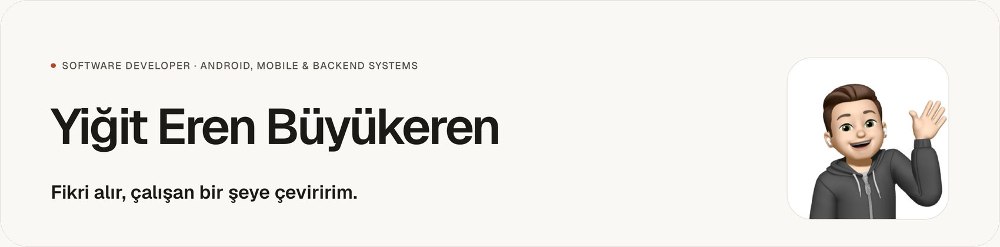
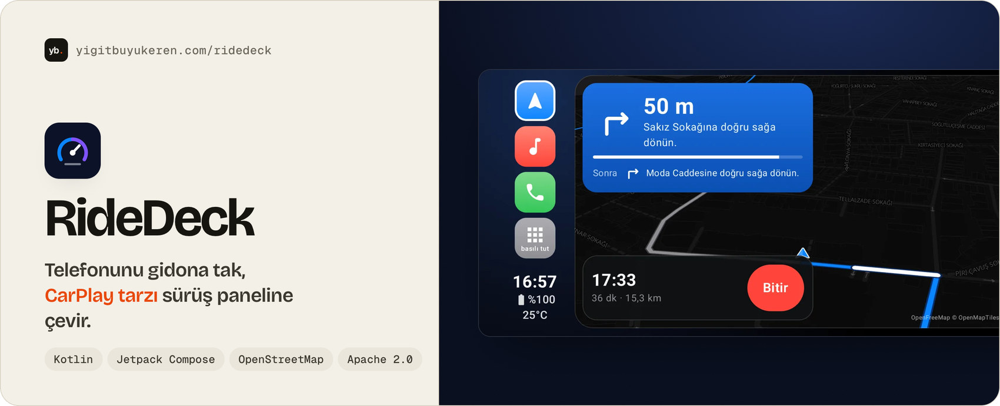
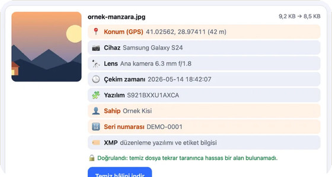
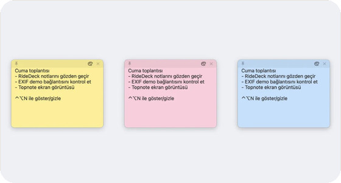
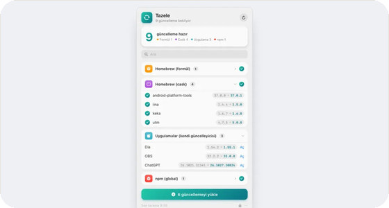
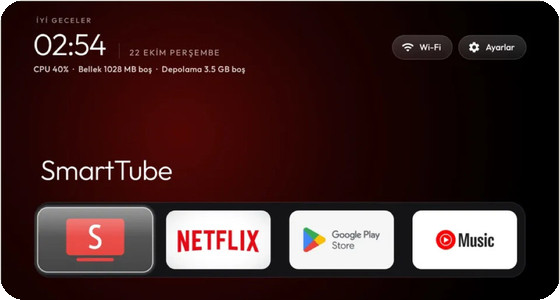

<a href="https://yigitbuyukeren.com/en/">
  <picture>
    <source media="(prefers-color-scheme: dark)" srcset="assets/banner-hero-dark.jpg">
    
  </picture>
</a>

  <b>Android · Mobile · Backend</b> &nbsp;·&nbsp; Istanbul 
  I build the app, the server, and the tests that keep both honest. 
  Currently: <b>RideDeck 0.6.0</b> — an open-source motorcycle dashboard.  
  <a href="https://yigitbuyukeren.com/en/">Website</a> &nbsp;·&nbsp;
  <a href="https://yigitbuyukeren.com/en/cv/Yigit-Eren-Buyukeren-CV-EN.pdf">CV</a> &nbsp;·&nbsp;
  <a href="mailto:mail@yigitbuyukeren.com">Email</a> &nbsp;·&nbsp;
  <a href="#türkçe">Türkçe</a>

---

## RideDeck

**Flagship · open source · Android**

<a href="https://github.com/yigitbuyukeren/ridedeck">
  <picture>
    <source media="(prefers-color-scheme: dark)" srcset="assets/ridedeck-dark.jpg">
    
  </picture>
</a>

Mount a phone on the handlebar and RideDeck replaces the phone UI with a CarPlay-style riding display: GPS speed, voice-guided OpenStreetMap navigation, music, calls, and an optional SOS/crash countdown. The controls are sized for gloves, and text entry is locked while moving.

Open source, no account, and no backend of its own. It is motorcycle-only by design.

| | |
|---|---|
| **Release** | `v0.6.0` · signed APK · Apache 2.0 |
| **Proof** | Latest CI (17 Nov): 742/742 JVM tests · static 16 KB alignment |
| **Stack** | Kotlin · Jetpack Compose · MapLibre · OpenStreetMap · Valhalla |
| **Limits** | Emulator screenshots; no real-device ride/SMS test. Routes, search and weather need a connection. SOS/crash thresholds are not field-tuned. |

**[Download APK](https://github.com/yigitbuyukeren/ridedeck/releases/latest)** · [Source](https://github.com/yigitbuyukeren/ridedeck) · [Project page](https://yigitbuyukeren.com/en/ridedeck/)

Verification history: [STATUS.md](https://github.com/yigitbuyukeren/ridedeck/blob/main/docs/STATUS.md) (TR).

---

## More work

### Aile Cüzdanı

A shared household budget for Turkish families: income, expenses, installments, subscriptions and savings goals in one place, for up to five family members. React Native · Expo · TypeScript · PocketBase, with authorization enforced on the server. Private source; in development, not in the stores. [Showcase](https://github.com/yigitbuyukeren/aile-cuzdani-showcase)

### Veil

Privacy-first Android messaging in closed-alpha development: a SimpleX-based client with a Tor-only policy for messages and files (opt-in calls are the exception), and no phone number or email. Release decision is **NO-GO** — there is no independent security audit or real-device verification yet. [Source](https://github.com/yigitbuyukeren/veil) · [Status](https://github.com/yigitbuyukeren/veil/blob/main/docs/veil/DEVELOPMENT_STATUS.md)

### Smaller tools

<table>
  <tr>
    <td width="50%" align="center" valign="top">
      <a href="https://github.com/yigitbuyukeren/exif-temizleyici"><picture><source media="(prefers-color-scheme: dark)" srcset="assets/exif-thumb-dark.jpg"></picture></a> 
      <b>EXIF Cleaner</b> 
      Metadata removal · JS · 38 tests <a href="https://github.com/yigitbuyukeren/exif-temizleyici">Source</a> · <a href="https://yigitbuyukeren.github.io/exif-temizleyici/">Demo</a>
    </td>
    <td width="50%" align="center" valign="top">
      <a href="https://github.com/yigitbuyukeren/topnote"><picture><source media="(prefers-color-scheme: dark)" srcset="assets/topnote-thumb-dark.jpg"></picture></a> 
      <b>Topnote</b> 
      Always-on-top macOS note · Swift · 7 tests <a href="https://github.com/yigitbuyukeren/topnote">Source</a> · <a href="https://github.com/yigitbuyukeren/topnote/releases/latest">Download</a> (ad-hoc signed)
    </td>
  </tr>
  <tr>
    <td width="50%" align="center" valign="top">
      <a href="https://github.com/yigitbuyukeren/tazele"><picture><source media="(prefers-color-scheme: dark)" srcset="assets/tazele-thumb-dark.jpg"></picture></a> 
      <b>Tazele</b> 
      One update hub for macOS apps · Swift · 149 tests <a href="https://github.com/yigitbuyukeren/tazele">Source</a> · MVP
    </td>
    <td width="50%" align="center" valign="top">
      <a href="https://github.com/yigitbuyukeren/tvplus-4k-box-rehber"><picture><source media="(prefers-color-scheme: dark)" srcset="assets/tvplus-thumb-dark.jpg"></picture></a> 
      <b>TV+ 4K Box</b> 
      Root-free ADB guide ~460 → ~930 MB free RAM (test unit) <a href="https://github.com/yigitbuyukeren/tvplus-4k-box-rehber">Source</a>
    </td>
  </tr>
</table>

**Also on GitHub:** [Unfollow Radar](https://github.com/yigitbuyukeren/unfollow-radar) · [Sohbet Özeti](https://github.com/yigitbuyukeren/sohbet-ozeti) ([demo](https://yigitbuyukeren.github.io/sohbet-ozeti/)) · [Kalp QR](https://github.com/yigitbuyukeren/kalp-qr) · [Doğum Günü Sürprizi](https://github.com/yigitbuyukeren/dogum-gunu-surprizi) ([demo](https://yigitbuyukeren.com/dogum-gunu/)) · [Mayın Tarlası 3D](https://github.com/yigitbuyukeren/mayin-tarlasi-3d) · [GitHub Achievements Guide](https://github.com/yigitbuyukeren/github-basarimlari-rehber)

---

## Open source

**12 merged upstream pull requests across 8 projects (Nov 2026).** Bug fixes, package definitions, type hints and Turkish localization for tools I use.

### Floe

[Floe](https://github.com/jannskiee/floe) is an encrypted peer-to-peer file transfer tool for the browser, desktop and CLI. Three merged fixes:

- **CLI:** a closed terminal or lost SSH session now cancels like Ctrl+C and tells the peer. [#860](https://github.com/jannskiee/floe/pull/860)
- **Engine:** pipes, sockets and devices are rejected instead of being sent as files. [#861](https://github.com/jannskiee/floe/pull/861)
- **Desktop:** settings files with UTF-8 and UTF-16 LE byte-order marks load correctly. [#827](https://github.com/jannskiee/floe/pull/827)

### Other contributions

- **[deb-get](https://github.com/wimpysworld/deb-get)** — package definitions for IPTVnator and Ghost Downloader. [#2073](https://github.com/wimpysworld/deb-get/pull/2073) · [#2072](https://github.com/wimpysworld/deb-get/pull/2072)
- **[pysad](https://github.com/selimfirat/pysad)** — full type hints for HalfSpaceTrees and xStream. [#471](https://github.com/selimfirat/pysad/pull/471)
- **Turkish localization** — [Capso](https://github.com/lzhgus/Capso/pull/387), [RemoveMacAI](https://github.com/omlahore/RemoveMacAI/pull/113), [ClipQR](https://github.com/MojeZcg/ClipQR/pull/49) and the [MyIP README](https://github.com/jason5ng32/MyIP/pull/541).
- **ClipQR** — stopped the Spanish "sin códigos" text from being clipped on macOS. [#50](https://github.com/MojeZcg/ClipQR/pull/50)
- **[cleanyourtv](https://github.com/Gathin23/cleanyourtv)** — Turkcell TV+ 4K Box (SDMC DV6069Y) configuration. [#874](https://github.com/Gathin23/cleanyourtv/pull/874)

---

## Toolkit

| | |
|---|---|
| **Mobile** | Kotlin · Jetpack Compose · MapLibre · Gradle · ADB · React Native · Expo · TypeScript |
| **Backend** | PocketBase · REST · Python · Node.js |
| **Desktop** | Swift · SwiftUI · AppKit |
| **Infra** | Git · GitHub Actions · Linux · Caddy · VPS · Tailscale · Cloudflare |

---

## Contact

For work, collaboration or a technical question: **[mail@yigitbuyukeren.com](mailto:mail@yigitbuyukeren.com)** 
[Website](https://yigitbuyukeren.com/en/) · [CV (EN)](https://yigitbuyukeren.com/en/cv/Yigit-Eren-Buyukeren-CV-EN.pdf) · [Site source](https://github.com/yigitbuyukeren/yigitbuyukeren.github.io)

Certificates and coursework

Course-completion certificates, not the full CCNA certification.

| Course | Issuer | Completed |
|---|---|---|
| CCNA: Introduction to Networks | Cisco Networking Academy | Mar 2026 |
| Linux Unhatched | Cisco Networking Academy | Feb 2026 |
| Introduction to Cybersecurity | Cisco Networking Academy | Feb 2026 |
| Network Fundamentals Training (CCNA ITN) | Bilişim Academy | Feb 2026 |
| Ağ Temelleri | BTK Akademi | Dec 2025 |
| Bilgisayar Ağları | BTK Akademi | Dec 2025 |

---

## Türkçe

Android, mobil ve sunucu sistemleri geliştiriyorum. Uygulamayı, arkasındaki sunucuyu ve ikisini de dürüst tutan testleri birlikte yazıyorum.

**Ana proje: RideDeck.** Telefonu gidona takınca CarPlay tarzı sürüş paneline çeviren açık kaynak Android uygulaması. Yalnız motosiklet için: GPS hızı, OpenStreetMap ile sesli navigasyon, müzik, telefon ve isteğe bağlı SOS. Hesap yok; kendine ait sunucusu yok. Ekran görüntüleri emülatörden; gerçek cihazda sürüş/SMS testi yok. Rota, arama ve hava durumu bağlantı ister; SOS/kaza eşikleri sahada ayarlanmadı. [APK](https://github.com/yigitbuyukeren/ridedeck/releases/latest) · [Kaynak](https://github.com/yigitbuyukeren/ridedeck) · [Proje sayfası](https://yigitbuyukeren.com/ridedeck/)

**Diğer projeler:** [Aile Cüzdanı](https://github.com/yigitbuyukeren/aile-cuzdani-showcase) (özel kaynak, geliştirmede) · [Veil](https://github.com/yigitbuyukeren/veil) (kapalı alfa geliştirmesi, NO-GO; mesaj ve dosyalarda Tor, isteğe bağlı aramalar istisna) · [EXIF Temizleyici](https://github.com/yigitbuyukeren/exif-temizleyici) · [Topnote](https://github.com/yigitbuyukeren/topnote) · [Tazele](https://github.com/yigitbuyukeren/tazele) · [TV+ 4K Box Rehberi](https://github.com/yigitbuyukeren/tvplus-4k-box-rehber)

**Açık kaynak:** 8 projede birleştirilmiş 12 upstream PR var. Floe'da üç düzeltme birleştirildi: terminal kapanınca veya SSH oturumu düşünce Ctrl+C gibi iptal etme, dosya toplarken pipe/socket/aygıtları reddetme, BOM'lu ayar dosyalarını okuma. Diğerleri: deb-get, pysad, Capso, RemoveMacAI, ClipQR, MyIP ve cleanyourtv.

**İletişim:** [mail@yigitbuyukeren.com](mailto:mail@yigitbuyukeren.com) · [Web](https://yigitbuyukeren.com) · [CV (TR)](https://yigitbuyukeren.com/cv/Yigit-Eren-Buyukeren-CV-TR.pdf)

<a href="#">Başa dön ↑</a>

Visuals use existing site and project art; the RideDeck banner comes from its repository. No new screenshots were generated.
