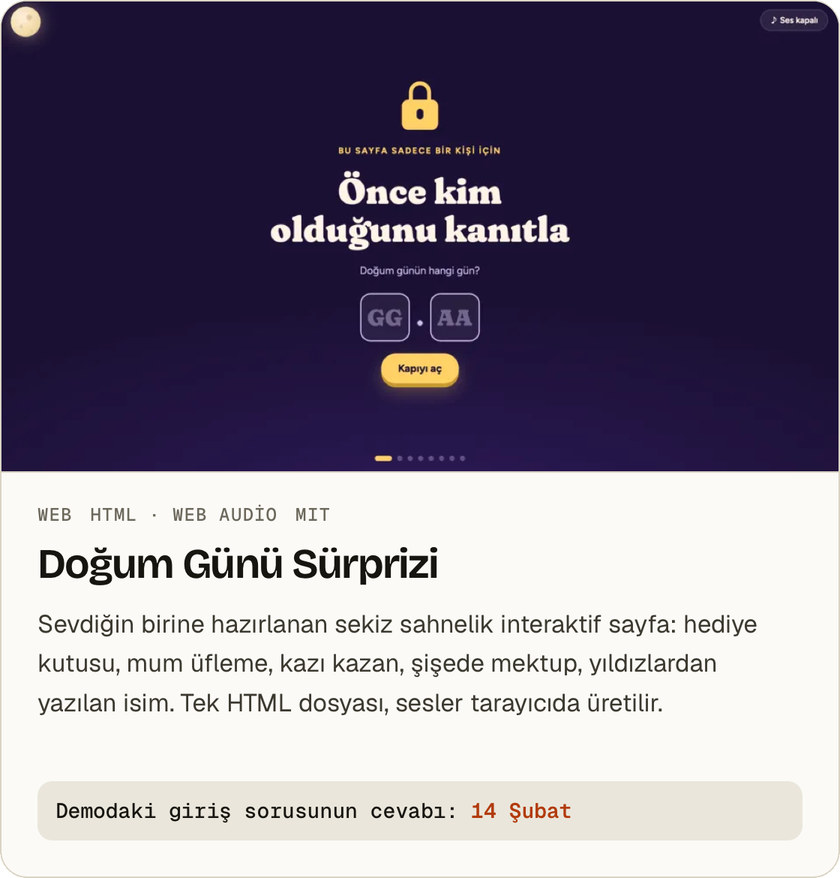
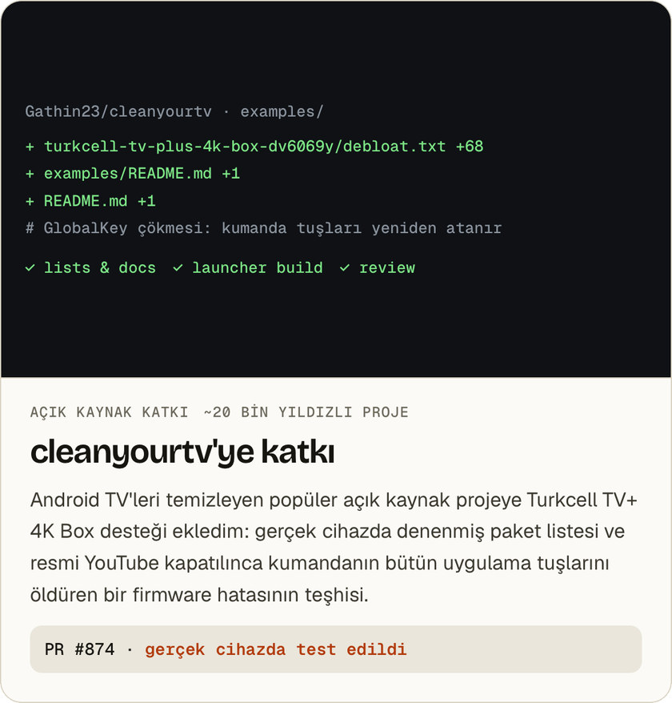

<a href="https://yigitbuyukeren.com">
  <picture>
    <source media="(prefers-color-scheme: dark)" srcset="assets/banner-dark.jpg">
    
  </picture>
</a>

  <a href="https://yigitbuyukeren.com"><b>yigitbuyukeren.com</b></a> ·
  <a href="mailto:mail@yigitbuyukeren.com">mail@yigitbuyukeren.com</a> ·
  <a href="https://yigitbuyukeren.com/en/">English</a>

Merhaba, ben Yiğit. Mobil uygulama, Android, sunucu ve ağ üzerinde çalışıyorum. Ekrandaki arayüzü de, arkasındaki sunucuyu da, onu ayakta tutan altyapıyı da kendim kurarım ve çalıştığını testle gösteririm.

## Seçili işler

<a href="https://yigitbuyukeren.com/aile-cuzdani/">
  <picture>
    <source media="(prefers-color-scheme: dark)" srcset="assets/aile-dark.jpg">
    
  </picture>
</a>

**Aile Cüzdanı** · [Proje sayfası](https://yigitbuyukeren.com/aile-cuzdani/) · [Tanıtım deposu](https://github.com/yigitbuyukeren/aile-cuzdani-showcase)

<a href="https://yigitbuyukeren.com/ridedeck/">
  <picture>
    <source media="(prefers-color-scheme: dark)" srcset="assets/ride-dark.jpg">
    
  </picture>
</a>

**RideDeck** · [Proje sayfası](https://yigitbuyukeren.com/ridedeck/) · [Kaynak kodu](https://github.com/yigitbuyukeren/ridedeck) · [APK indir](https://github.com/yigitbuyukeren/ridedeck/releases/latest)

### Diğer işler

  <a href="https://github.com/yigitbuyukeren/tvplus-4k-box-rehber"><picture><source media="(prefers-color-scheme: dark)" srcset="assets/tvplus-dark.jpg"></picture></a>
  <a href="https://github.com/yigitbuyukeren/unfollow-radar"><picture><source media="(prefers-color-scheme: dark)" srcset="assets/unfollow-radar-dark.jpg"></picture></a>

[TV+ 4K Box Rehberi](https://github.com/yigitbuyukeren/tvplus-4k-box-rehber) · [Unfollow Radar](https://github.com/yigitbuyukeren/unfollow-radar)

  <a href="https://yigitbuyukeren.com/dogum-gunu/"><picture><source media="(prefers-color-scheme: dark)" srcset="assets/dogum-gunu-dark.jpg"></picture></a>
  <a href="https://github.com/Gathin23/cleanyourtv/pull/874"><picture><source media="(prefers-color-scheme: dark)" srcset="assets/cleanyourtv-dark.jpg"></picture></a>

[Doğum Günü Sürprizi (canlı demo)](https://yigitbuyukeren.com/dogum-gunu/) · [Kaynak](https://github.com/yigitbuyukeren/dogum-gunu-surprizi) · [cleanyourtv PR #874](https://github.com/Gathin23/cleanyourtv/pull/874)

## Şu an

- **Durum:** Yeni projelere açığım.
- **Odak:** Aile Cüzdanı'nı mağaza yayınına hazırlıyorum.
- **Son iş:** TV+ 4K Box rehberi ve bu kutunun cleanyourtv'ye eklenmesi.
- **Site:** [yigitbuyukeren.com](https://yigitbuyukeren.com) baştan tasarlandı. Framework yok, düz HTML ve CSS, kendi sunucumda Caddy ile yayında.

## Nasıl çalışıyorum

1. **Önce kanıt.** Tip kontrolü, lint, birim testleri ve gerçek bir sunucuya karşı entegrasyon testleri geçmeden iş bitmiş sayılmaz.
2. **Yazıya dökülmüş kararlar.** Proje durumu, kararlar ve çalıştırma kılavuzları repoda durur. Aylar sonra dönen biri, ben dahil, nereden devam edeceğini bilir.
3. **Gerektiği kadar veri.** RideDeck'te hesap ve sunucu yok, Unfollow Radar veriyi tarayıcıdan çıkarmıyor. Toplanması gerekmeyen veri toplanmaz.
4. **Geri dönüşü olan değişiklik.** Canlı bir sisteme dokunan her adımın geri alma yolu olur: önce yedek, sonra deneme modu, gerekirse tek komutla geri dönüş.

## Kullandıklarım

| | |
|---|---|
| **Mobil** | `React Native` `Expo` `TypeScript` |
| **Android** | `Kotlin` `Jetpack Compose` `MapLibre` `ADB` `Root ve ROM` |
| **Sunucu** | `PocketBase` `JavaScript` `Python` `REST API` |
| **Altyapı** | `Linux` `Caddy` `VPS` `Tailscale` `Cloudflare` `Raspberry Pi` |
| **Web** | `HTML` `CSS` `JavaScript` `Web Audio` |
| **Ağ** | `TCP/IP` `Alt ağlar` `Temel yönlendirme` |

<b>Sertifikalar</b>

| Sertifika | Veren | Tarih |
|---|---|---|
| CCNA: Introduction to Networks | Cisco | Mart 2026 |
| Linux Unhatched | Cisco Networking Academy | Şubat 2026 |
| Introduction to Cybersecurity | Cisco | Şubat 2026 |
| Network Fundamentals Training (CCNA ITN) | Bilişim Academy | Şubat 2026 |
| Ağ Temelleri | BTK Akademi | Aralık 2025 |
| Bilgisayar Ağları | BTK Akademi | Aralık 2025 |

## İletişim

**Bir fikrin mi var? Birlikte kuralım.** Proje, iş birliği ya da teknik bir soru için [mail@yigitbuyukeren.com](mailto:mail@yigitbuyukeren.com) adresine yazabilirsin. Genellikle birkaç gün içinde dönerim.

<b>In English</b>

I'm Yiğit, a software developer in Istanbul. I take an idea and make it work: mobile apps, Android, servers and networks. I build the interface, the server behind it and the infrastructure that keeps it running, and I prove it works with tests.

- **[Aile Cüzdanı](https://github.com/yigitbuyukeren/aile-cuzdani-showcase)**: a free, shared budgeting app for Turkish families (React Native, Expo, PocketBase), in development.
- **[RideDeck](https://yigitbuyukeren.com/en/ridedeck/)**: an open-source, CarPlay-style Android riding dashboard for motorcycles, cars and bikes (Kotlin, Jetpack Compose).
- **[TV+ 4K Box Guide](https://github.com/yigitbuyukeren/tvplus-4k-box-rehber)**: a root-free, reversible cleanup guide and scripts for Turkcell's set-top box, also contributed to [cleanyourtv](https://github.com/Gathin23/cleanyourtv/pull/874).
- **[Unfollow Radar](https://github.com/yigitbuyukeren/unfollow-radar)**: find who doesn't follow you back on Instagram; paste into the console, data never leaves the browser.
- **[Birthday Surprise](https://github.com/yigitbuyukeren/dogum-gunu-surprizi)**: an eight-scene interactive birthday page in a single HTML file ([live demo](https://yigitbuyukeren.com/dogum-gunu/)).

More on [yigitbuyukeren.com/en](https://yigitbuyukeren.com/en/) · [mail@yigitbuyukeren.com](mailto:mail@yigitbuyukeren.com)

Görseller [yigitbuyukeren.com](https://yigitbuyukeren.com)'un kendi kartlarından üretilir: [`tools/render.sh`](tools/render.sh).
