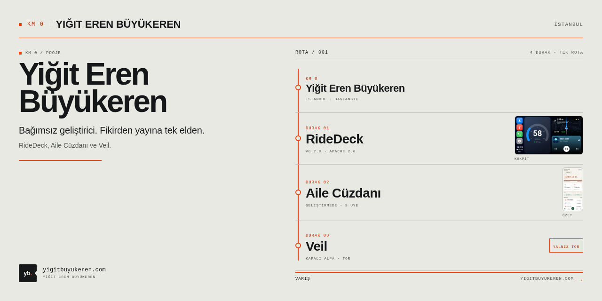

<a href="https://yigitbuyukeren.com/">
  <picture>
    <source media="(prefers-color-scheme: dark)" srcset="assets/portfolio-dark.png">
    
  </picture>
</a>

# Yiğit Eren Büyükeren

İstanbul’da mobil uygulamalar geliştiriyorum. İki ana projem var: motosiklette gidona takılan telefon için **RideDeck** ve ailelerin bütçelerini birlikte takip edebilmesi için **Aile Cüzdanı**.

[Web sitesi](https://yigitbuyukeren.com/) · [CV](https://yigitbuyukeren.com/cv/) · [E-posta](mailto:mail@yigitbuyukeren.com) · [English ↓](#english)

### RideDeck · Motosiklet sürüş paneli

Android telefonu yatay bir sürüş ekranına çevirir. Tek ekranda GPS hızı, sesli dönüş talimatları, müzik ve aramalar bulunur. Hesap gerektirmez. Kotlin, Jetpack Compose ve MapLibre ile geliştiriyorum.

**0.7.0 kararlı sürüm** · Açık kaynak (Apache 2.0). Android 13 ve üzerinde Türkçe ve İngilizce arasında uygulamayı kapatmadan geçilebilir. SOS/kaza algılama deneyseldir; gerçek sürüş ve SMS teslimi doğrulanmadı.

[İmzalı APK ↓](https://github.com/yigitbuyukeren/ridedeck/releases/download/v0.7.0/RideDeck-0.7.0.apk) · [Kaynak kod](https://github.com/yigitbuyukeren/ridedeck) · [Ekranlar ve kurulum](https://yigitbuyukeren.com/ridedeck/)

### Aile Cüzdanı · Ortak aile bütçesi

“Bir sonraki maaşa kadar ne kadar harcayabiliriz?” Beş kişiye kadar aile üyeleri gelirlerini, taksitlerini, faturalarını ve birikim hedeflerini aynı bütçede görebilir. Bütçe dönemi maaş gününde başlayabilir; dönem raporu PDF veya CSV olarak paylaşılabilir.

**Geliştirmede** · Kaynak kodu özel; Google Play veya App Store’da yayımlanmadı. React Native, Expo ve TypeScript ile yazdığım istemcide aile rollerinin erişim sınırlarını PocketBase sunucusu uygular. Tanıtım ekranları demo verisi kullanır.

[Ekranları incele](https://yigitbuyukeren.com/aile-cuzdani/) · [GitHub tanıtımı ve mimari](https://github.com/yigitbuyukeren/aile-cuzdani-showcase) · [Gizlilik](https://yigitbuyukeren.com/aile-cuzdani/gizlilik/)

### English

I’m an independent developer in Istanbul. **[RideDeck](https://yigitbuyukeren.com/en/ridedeck/)** puts navigation, GPS speed, music and calls on a motorcycle-mounted Android phone. It is open source, with a [signed 0.7.0 release](https://github.com/yigitbuyukeren/ridedeck/releases/tag/v0.7.0). Crash detection and SOS are experimental.

**[Aile Cüzdanı](https://yigitbuyukeren.com/en/aile-cuzdani/)** (“Family Wallet”) helps households budget from payday to payday, plan instalments and save towards shared goals. The source is private and the app is in development; the [public showcase](https://github.com/yigitbuyukeren/aile-cuzdani-showcase) has demo screens and architecture notes.

[Website in English](https://yigitbuyukeren.com/en/) · [CV](https://yigitbuyukeren.com/en/cv/) · [Other repositories](https://github.com/yigitbuyukeren?tab=repositories)
